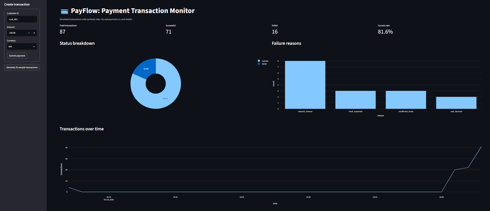
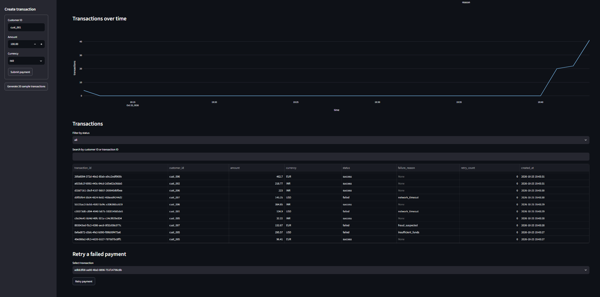
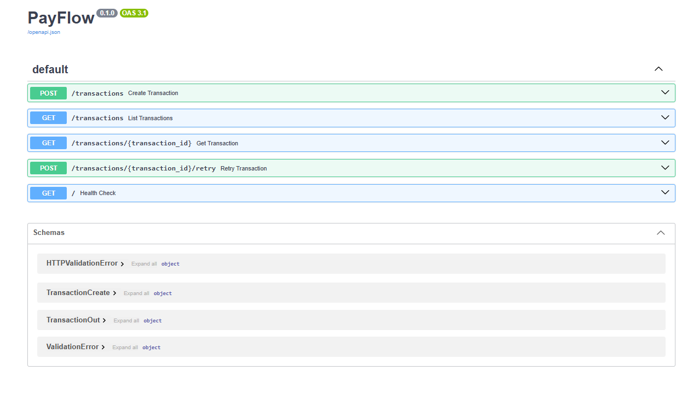

# 💳 PayFlow: Payment Transaction Monitoring System

A simulated payment processing and monitoring service built with FastAPI. It records transactions, tracks their status, retries failures, prevents duplicate processing, and shows analytics on a Streamlit dashboard.

> **Note:** PayFlow is a simulation using synthetic data. It does not process real payments or store card details.


## Features

- REST API with input validation, pagination and status filtering
- **Idempotency keys** so a repeated request returns the original transaction instead of creating a duplicate
- **Bounded retries** for failed payments (max 3), with HTTP 409 for invalid retries
- Unique database constraint as a safety net for concurrent duplicate requests
- Streamlit dashboard: success rate, failure reasons, trends, searchable table, retry button
- 12 automated Pytest tests with an isolated in-memory database
- GitHub Actions CI that runs the tests on every push

## Architecture

```
Streamlit dashboard  ──HTTP──▶  FastAPI (routes, validation)  ──SQLAlchemy──▶  SQLite
```

The dashboard never touches the database directly. It only calls the API, so the UI and backend stay decoupled.

| File | Responsibility |
|---|---|
| `app/main.py` | App setup and health check |
| `app/routes.py` | Endpoints and payment simulation logic |
| `app/models.py` | Database table definition |
| `app/schemas.py` | Request and response validation (Pydantic) |
| `app/database.py` | Engine and session management |
| `dashboard/app.py` | Streamlit dashboard |
| `tests/` | Pytest suite and test database fixture |

## API endpoints

| Method | Endpoint | Purpose |
|---|---|---|
| GET | `/` | Health check |
| POST | `/transactions` | Create a transaction (optional `idempotency_key`) |
| GET | `/transactions` | List transactions (`status`, `skip`, `limit`) |
| GET | `/transactions/{transaction_id}` | Get one transaction (404 if missing) |
| POST | `/transactions/{transaction_id}/retry` | Retry a failed transaction (409 if not retryable) |

## Run locally

```bash
python -m venv .venv
.\.venv\Scripts\Activate.ps1      # Windows PowerShell
python -m pip install -r requirements.txt
```

Start the API (interactive docs at `http://127.0.0.1:8000/docs`):

```bash
uvicorn app.main:app --reload
```

Start the dashboard in a second terminal:

```bash
streamlit run dashboard/app.py
```

Run the tests:

```bash
python -m pytest -v
```

## Design decisions

- **Idempotency keys:** if a client retries after a network failure, the server returns the original result rather than processing the payment twice. Payment APIs commonly work this way.
- **404 vs 409:** 404 means the transaction does not exist. 409 means the request is valid but conflicts with current state, such as retrying a successful payment or one that is out of retries.
- **Retry cap:** limits retries to 3 to avoid endless retry loops.
- **Deterministic tests:** the random success/failure simulation is patched in tests, so they never fail by chance.
- **Money as float:** acceptable for a simulation. A production system would use integer cents or `Decimal`.

## Screenshots





## Possible improvements

PostgreSQL, authentication, rate limiting, structured logging and Docker.

## License

MIT